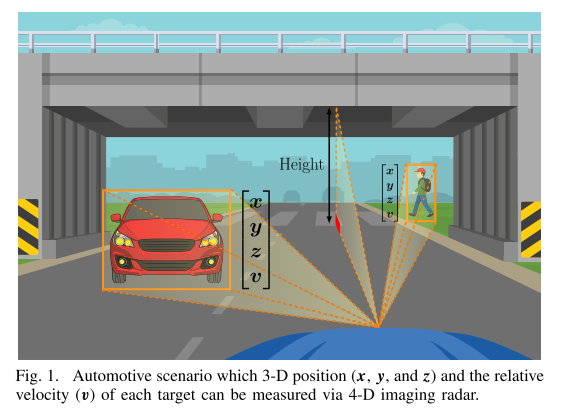
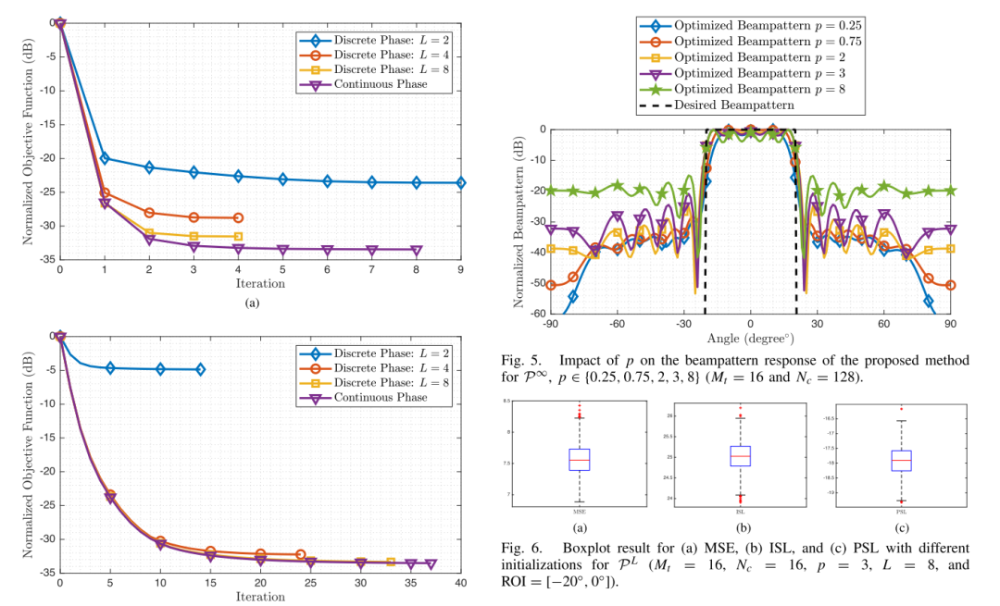
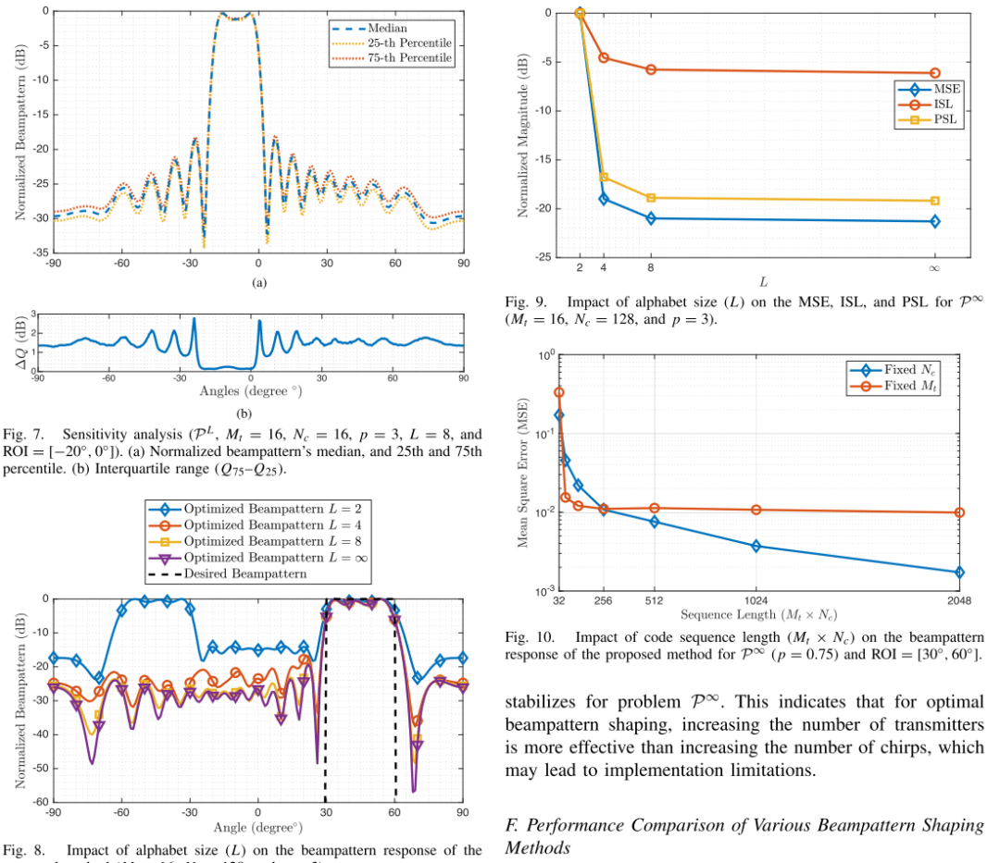
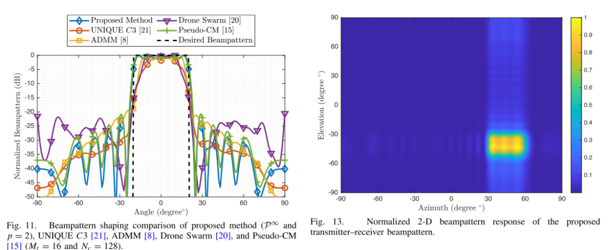
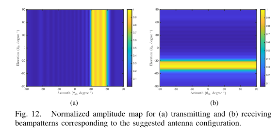
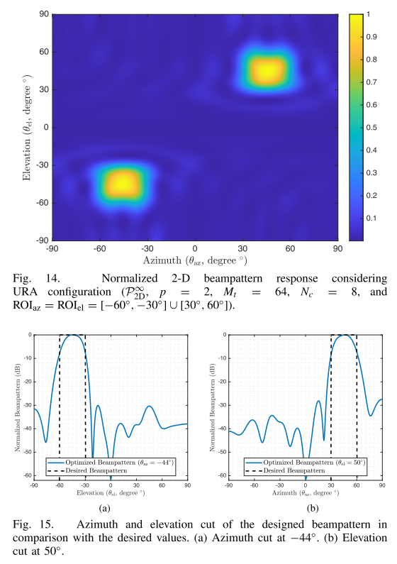
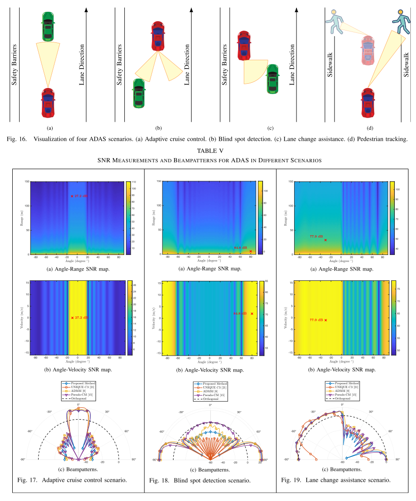

# [BF+4D Radar Imaging]Four-Dimensional Imaging MIMO Radar Beamforming [with MATLAB Code]

Introduction: Multi-Input Multi-Output (MIMO) Radar Technology in the Automotive Industry Enhances Advanced Driver Assistance Systems (ADAS) by enabling robust target detection, precise positioning, and effective interference mitigation. Comprehensive environmental sensing is crucial for automotive safety systems. Traditionally, this objective required various radar technologies, each suitable for a specific function: Long Range Radar (LRR) for adaptive cruise control, Medium Range Radar (MRR) for intersection alert and lane change assistance, and Short Range Radar (SRR) for parking assistance, obstacle detection, pedestrian detection, and blind spot detection. However, using these radar systems simultaneously presents significant challenges to vehicle architecture integration and cost.
4D Imaging Radar is a high-resolution, long-range sensor technology that is crucial for the automotive industry, especially in ADAS. Unlike traditional three-dimensional radars that capture distance, direction, and relative speed, 4D radars also collect vertical information, enabling the identification of object height as shown in Figure 1. This capability is vital for determining whether vehicles can navigate over obstacles such as bridges and enhances object detection and road boundary recognition under various driving conditions. 4D Imaging Radar supports the development of higher levels of autonomous driving by improving environmental perception and decision accuracy. Additionally, 4D Imaging technology serves as an alternative solution to integrate the functions of LRR, MRR, and SRR into a single antenna configuration through adaptive spatial power distribution control. This approach requires precise radar beam pattern design through adaptive space power distribution control.
Recent advancements in radar technology have integrated Radar Cross Section (RCS) into 4D radar data, leading to the development of 5D radar for better environmental perception [1]. The use of 5D radar point clouds improves the accuracy of reconstructed images, such as pedestrian behavior interpretation [2] and sleep posture monitoring [3]. However, the increased complexity and data processing requirements of 5D radar present challenges.
The beamforming in radar systems can be achieved through two main methods: antenna arrangement and the design of code sequences for each transmit antenna [4]. This paper focuses on the latter, exploring code design to shape and optimize beam patterns. The optimal performance of MIMO radar systems is influenced by waveform design and beamforming [5]. These fundamental elements can enhance the system's ability to detect and distinguish targets, resulting in better performance [6]. The beamforming process involves manipulating radiated power within a specific spatial region at desired angles while reducing interference from sidelobe echoes to enhance target detection capability [7]. There has been extensive research on waveform design for beamforming, employing various methods, including variable selection, determination of objective functions, and application of constraints.
Beamforming in MIMO radar is described as an NP-hard and multivariable problem, specifically discussed in [23] with regard to discrete phases. The BSUM method, using block continuous upper bound minimization (BSUM), approximates the main function to a more direct form during each iteration, making the problem easier to solve. When p ≥ 2, this method allows effective beam pattern formation for DQP norms, demonstrating good performance. However, its limitations, including its applicability only to discrete phases and specific constraints on p values, can be seen as its drawbacks.
In [24], two CD-based algorithms are used to solve the emission waveform design for colocated MIMO radar with CE constraints. The first algorithm approximates the desired beam directional pattern through cyclic scalar minimization, solving the non-convex problem. The second is further improved to approximate the specified covariance matrix. These methods, suitable for finite alphabets and continuous phase codes, incorporate strategies to reduce computational costs. However, in this work, the Jacobi style (one-time) CD method was adopted, although it achieves convergence, but it is slow [25]. This is mainly due to the large number of iterations required for convergence, leading to increased time consumption.
Designing code sequences for MIMO radar helps in forming beam patterns in a manner that is most suitable for the operational needs of the radar system. These codes can help achieve various desired characteristics, such as beam steering, which focuses the main beam on a specific direction. This is achieved by controlling the phase and amplitude of the signals transmitted from the transmitter [28].
Real-time processing is crucial for dynamically adjusting the beam pattern, and it is essential for effective target tracking and detection. Fast-changing scenes require high-resolution, real-time target detection capabilities, highlighting the importance of advanced radar systems in real-time data processing and tracking moving targets [30].
This paper addresses the challenges of beam pattern formation in automotive MIMO radar systems within the BSUM framework. Our primary focus is on maintaining practical aspects of low complexity solutions, which are necessary for real-world applications in 4-D imaging scenarios. The main work of this paper is summarized as follows.
1) We address the continuous and discrete phase constraints (0 < p ≤ 1 ≤ p ≥ 2) using the BSUM method to solve the beam pattern formation problem.
2) We propose a method to improve the spatial power distribution of automotive radar systems specifically for 4-D imaging applications.
3) The proposed method supports a range of antenna configurations, including uniform linear arrays (UWB) and uniform rectangular arrays (URA), to enhance directional flexibility and angular resolution in the radar system.
4) Our method includes a continuous phase modulation scenario where p ≥ 2.
5) We ensure that our proposed method converges to the objective function and parameters, establishing a new stopping criterion for optimization problems.
6) We have successfully demonstrated that the proposed method outperforms typical all-directional beam patterns in various automotive scenarios.
Article illustrations
Conclusion This paper proposes a method for designing code sequences for 4-D imaging vehicle MIMO radar system beamforming. We outline an optimization problem that seeks to minimize the distance between the expected and designed beam patterns via the generalized BFP norm, where we have successfully solved the problem for cases where 0 < p ≤ 1 and p ≥ 2. The problem is solved using the BSUM method. We present a discrete phase constraint based on FFT, a solution that can be easily implemented in real-time applications. We suggest solving the continuous phase constraint with a quadratic polynomial to obtain the best continuous phase, and we propose fast approximations of the continuous phase solutions with good accuracy.
Our analysis demonstrates the convergence of the solution, leading us to introduce a new stopping criterion for the optimization process. Simulation results not only support the effectiveness of our proposed method, showing consistent minimization of the objective function but also indicate its superior performance compared to typical all-directional beam patterns in automotive scenarios. Moreover, the proposed method exhibits satisfactory MSE between the designed and expected beam directional patterns, affirming its good performance and practicality. The prospects of implementing and enhancing these algorithms in real-world scenarios are immense, bringing significant hope for improving the performance of such systems.
MATLAB simulation results are consistent with the article illustrations.

## Images

<!-- PAYMENT_BLOCK -->

## Get this dataset

- Payment link (Stripe): [Buy now](https://buy.stripe.com/3cs8yP7sY87d0vu9AB)
- Payment QR code: 

<!-- /PAYMENT_BLOCK -->
